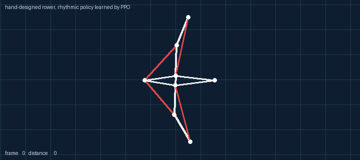
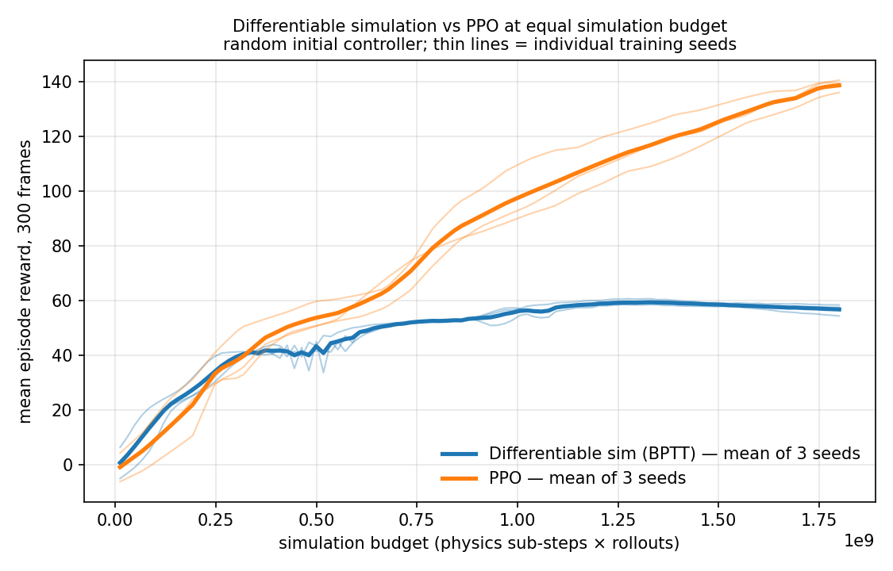
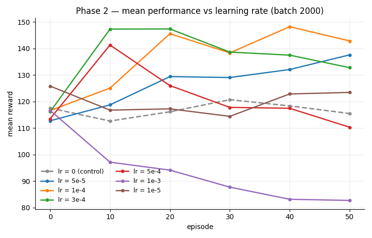
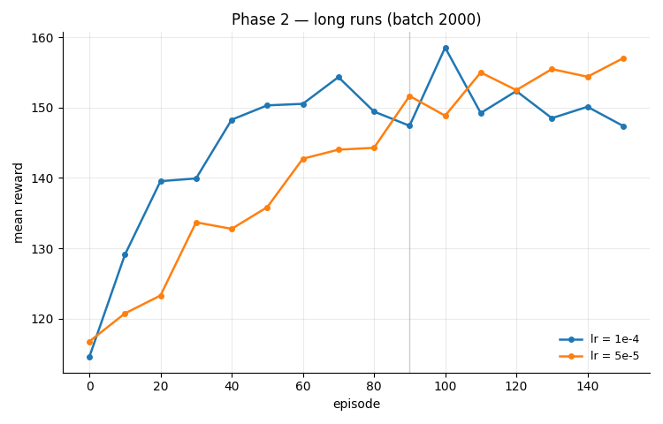

# 🧬 Massively Parallel Neuroevolution for Aquatic Soft-Body Locomotion




*Hand-designed rower morphology, rhythmic mirror-symmetric policy learned by PPO, in the
validated physics (E19, E22). Grid fixed in the water frame; blue line: trajectory of the
centre of mass.*

**Key findings**

- A GPU-vectorised, differentiable 2D mass-spring simulator written from scratch in PyTorch,
  with bit-identical GPU reruns and a `torch.compile` path (×3–4).
- At equal simulation budget, PPO beats learning by backpropagation through the simulator
  by ≈ 2.5× on every seed; the gradient-based learner plateaus because more than half of its
  tanh outputs saturate, where the analytic gradient vanishes (E13, E18, E18b).
- Learned controllers exploited two simulation artefacts — an unstable integration step and
  a velocity clip that created thrust; both were diagnosed with open-loop controls and
  removed (E12, E14).

## 📊 Main result — gradients through the simulator vs PPO



*Reference morphology, random initial controller, 3 training seeds per method, equal
simulation budget (1.8 × 10⁹ physics sub-steps × rollouts). Thin lines: individual seeds.*

| 300 frames, 50 rollouts | gradient through the simulator (`train2.py`) | PPO (`baselines/ppo.py`) |
|---|---|---|
| displacement (seeds 0/1/2) | 63.5 / 61.8 / 62.2 | **158.5 / 154.2 / 150.4** |
| commands saturated at ±1 | 55–58 % | 0–2 % |

At equal budget PPO beats the best variant of gradient-based learning through the
differentiable simulator by ≈ 2.5× on every seed and is still improving. The
gradient-based learner — truncated BPTT with one Adam step per 10-frame window, ×4.5
over one step per episode (E13) — plateaus at the same level whatever the reward
shaping (E18, E18b). The reason is identified: more than half of its tanh outputs are
saturated, where the analytic gradient is ≈ 0. Full protocol and numbers: E13, E18,
E18b in [EXPERIMENTS.md](EXPERIMENTS.md). (The earlier ×15 result, E11, was obtained in
an unstable physics and is superseded.)

## ⚠️ Open problem — sustained swimming

The training reward is the net displacement over 300 frames from rest. Nothing in it
requires the motion to *continue*: replayed over 1500 frames
([`tools/horizon_check.py`](tools/horizon_check.py)), most learned controllers move once
and freeze shortly after the training horizon (E16 correction, E18; one PPO seed in three
keeps swimming at λ = 0.3, E18b). Chaining the training episodes (E20) fixes the
incentive — PPO then swims continuously inside the chain — but the policies no longer
learn to start from rest, and the gradient-based learner freezes. In progress: E20b
(chained episodes with 10 % returns to rest) and E21 (a penalty on pre-tanh outputs to
keep train2's gradient alive).

On a body designed for this physics the problem largely disappears: PPO on the rower
swims at constant speed from rest (E19), and a **rhythmic policy** — the command depends
only on the phase of a swimming clock, with mirror muscles sharing one command — gives
the clean, symmetric stroke shown at the top (E22), at ≈ 25 % less speed than the
unconstrained, jerky policy.

Two control morphologies frame the question of body design: a hand-built eel (E17) and a
**rower designed from the drag model** (E19, [`tools/rameur.py`](tools/rameur.py)) whose
open-loop stroke already swims steadily and reverses when the stroke phase reverses.

## 🔧 Physics validation (E12, E14)

A numerical convergence test showed that the original integration step
(`sub_step = 10`) was unstable: a creature **at rest** drifted forward, and learned
controllers exploited the artefact. Physics converges from `sub_step = 20`, now the
default. A second test showed that the ±20 node-velocity clip also produced thrust that
PPO exploited; it is removed by default (the physics is stable without it).

| open-loop command, reference morphology, 300 frames | sub_step 10 | 20 | 40 | 80 |
|---|---|---|---|---|
| rest (a = 0) | **23.4** | 0.0 | 0.0 | 0.0 |
| slow travelling wave | 54.7 | 26.4 | 28.3 | 26.4 |
| bang-bang | **228.8** | 30.5 | 32.1 | 22.8 |

**Known limitation.** The reference morphology itself comes from phase 1 (evolution),
which ran in the original physics; phase 1 has not been re-run since the fixes.

## 🚀 Overview

This repository implements a custom, fully vectorized 2D physics engine built from scratch in PyTorch to simulate soft-body aquatic creatures.

Instead of relying on standard loops or pre-built engines, this project leverages `torch.func.vmap` to achieve **massively parallel neural network evaluations**. By vectorizing both the physics simulation and the Brain (Multi-Layer Perceptron), the engine evaluates 50 morphologies × 30 concurrent rollouts in a single batched pass.

## 🔬 Earlier bugs (E1–E10)

Before the comparisons above, four compounding specification and implementation bugs
had to be found. Full log in [EXPERIMENTS.md](EXPERIMENTS.md).

**Champion weights were saved after the optimiser step**, so every archived
champion was a post-update, degraded version of the policy that had earned the
score — a 34% reproduction gap.

**Selection used `argmax` over a single rollout**, rewarding a favourable initial
condition as much as a better policy. Replaced by one brain per morphology
trained on the mean gradient of 30 concurrent rollouts.

**Gradients through the stiff mass-spring simulator reached 1.3 × 10⁸** with a
60-frame BPTT window, so `clip_grad_norm_(1.0)` was normalising away all
magnitude information. Shortening the window to 10 frames brought the norm to
~870 and unblocked learning.

**Rest lengths were computed on the un-noised topology**, so every rollout started
out of equilibrium and spring relaxation supplied a free initial impulse — counted
by the reward, never charged by the energy penalty. Rest lengths are now
recomputed per rollout on the perturbed positions: every unit of displacement has
to come from a muscle command.

Before those fixes, a learning-rate sweep had already established that the
gradient direction was sound and the step size was the binding constraint:



*50 episodes, batch 2000. Larger steps rise faster and collapse earlier; the
lr = 0 control separates the gradient's contribution from exploration-noise
annealing.*



*Extending the two best settings to 150 episodes reverses the ranking — a sweep
truncated at 50 episodes would have picked the wrong one.*

## ⚙️ Core Architecture & Physics

The environment is designed to study Embodied AI and morphological evolution in fluid dynamics.

### 1. Vectorized Mass-Spring-Damper System

Creatures are dynamically generated as graphs of nodes (masses) and edges (muscles/bones). The physical interactions are resolved using matrix operations for high-throughput batch processing.

Because evolved morphologies differ in node and edge count, every creature is padded to a common size and masked, so a heterogeneous population fits in a single dense tensor. Those dimensions are **fixed for the whole run** (`max_noeuds_fixe`, `max_muscles_fixe`) rather than derived from the largest creature in the population: letting them float meant one creature growing shifted the blocks of the observation vector for every controller, so previously learned weights read the wrong inputs — the suspected cause of the abrupt performance drops observed at generations 14 and 23. Morphologies exceeding the fixed budget are rejected by an assertion at population assembly.

### 2. Hydrodynamic Drag Simulation

To force the neural networks to learn realistic swimming patterns rather than exploiting simulation glitches, a custom directional drag model is applied to every segment:

```
F_drag = -k_water * d * (v · n) * n
```

Where `d` is the segment length, `v` is the mean velocity of the connected nodes, and `n` is the normal vector of the segment.

A weaker tangential component (30% of the normal coefficient) is applied along the segment direction, and the drag coefficient is scaled per link type — bones drag at full strength while muscles are attenuated, approximating the difference between a rigid paddle and a compliant one.

### 3. Neural Control & Actuation

Each creature is controlled by a PyTorch Neural Network taking relative node coordinates, velocities, current muscle contraction and a rhythmic clock signal as inputs. The network outputs target muscle contractions, which set the resting length of the springs.

The control loop runs at a lower rate than the physics: the policy is queried **every 5 frames**, and each frame integrates **20 physics sub-steps** (`sub_step`; 10 before E12 showed it unstable). A new command therefore holds for 100 integration steps, which keeps the backpropagation graph tractable and forces the controller to produce sustained deformations rather than per-step corrections.

### 4. Optimisation Loop

Two nested processes run together:

- **Evolutionary search over morphology** — insertion of a mirrored node pair, deletion of a mirrored node pair (with index remapping and a BFS connectivity check), link retyping (bone ↔ muscle) and length perturbation, all constrained to preserve bilateral symmetry. Elitist selection keeps the top half of the population each generation; each survivor produces one mutated child.
- **Gradient-based controller learning** — rewards are backpropagated *through* the differentiable physics simulator. Training uses truncated BPTT (10-frame window), gradient-norm clipping (`max_norm = 10`), and automatic detection and recovery from numerical divergence (NaN check every 20 frames plus a finiteness check on the loss before `backward()`, episode discarded and graph freed). In phase 2 the comparisons use one Adam step per window (`--maj-par-fenetre`, E13) with the graph fully cut at window boundaries.

The two phases optimise the **same objective**: displacement with a constant energy
penalty (`coef_energie = 10000`, `coef_hauteur = 0` throughout). The energy term is
divided by `coef_energie`, so in practice it is 0.3–2 % of progress — energy is nearly
free. The shaping term that matters in the current experiments is the smoothness penalty
λ·Σ(a_t − a_{t−1})² on muscle commands (`coef_regularite`, λ = 0.3; E16). An earlier version
switched the objective mid-run — a curriculum — which made scores incomparable
across generations for a measured effect of −1.2%; it was removed. Phase 2 differs
from phase 1 only in that the morphology is frozen, the batch is much larger, the
horizon is longer (`train2_frame_nb = 300` vs `frame_nb = 200`), the exploration noise is annealed (0.030 → 0.005) and the Adam optimiser is never
re-instantiated.

## 📁 Repository Structure

| File | Role |
|---|---|
| `megaVecto.py` | Vectorised physics engine: springs, damping, hydrodynamic drag, observations, reward |
| `megaVecto_fast.py` | Same physics with incidence-matrix products instead of `scatter_add_` (bit-identical GPU reruns) and optional `torch.compile` (×3–4) |
| `individu.py` | Creature genome: topology and mutation operators (bilateral symmetry enforced) |
| `brain.py` | MLP controller (3 layers, tanh output) |
| `train.py` | Phase 1 — evolutionary topology search with controller learning |
| `train2.py` | Phase 2 — controller refinement on a frozen champion morphology |
| `visualize.py` | Renders a saved champion and exports an MP4 |
| `config.py` | Single `Config` dataclass + CLI parser shared by every script |
| `config.yaml` | Default values for every parameter — edit here rather than in the code |
| `logger.py` | Structured run logger: append-only JSONL + CSV with a growing schema |
| `evaluate_seeds.py` | Sweeps initial-condition seeds for a champion, ranks them by displacement |
| `verify_reproducibility.py` | Replays a champion under exact phase-1 training conditions to check its announced score |
| `champion.py` | Loads a saved champion and rebuilds its padded single-creature tensors |
| `baselines/env.py` | `SwimEnv`: the physics wrapped as a vectorised RL environment (no gradient); chained episodes and returns to rest (E20) |
| `baselines/check_env.py` | Proves `SwimEnv` reproduces the `train2.py` loop exactly — run before any baseline |
| `baselines/ppo.py` | PPO baseline on the frozen morphology, same simulation budget as `train2.py` |
| `baselines/compare.py` | Plots reward vs simulation budget: each training seed plus their mean; two panels with `--enchaines` |
| `tools/horizon_check.py` | Replays checkpoints far beyond the training horizon: does the gait keep going? |
| `tools/diagnose_gait.py` | Gait statistics: command saturation, chattering, vertical drift, energy per progress |
| `tools/convergence_test.py` | Open-loop commands across integration steps (the E12 test) |
| `tools/benchmark_physics.py` | Equivalence and speed of `megaVecto.py` vs `megaVecto_fast.py` |
| `politiques.py` | Structured commands (E22): mirror-symmetric policies and rhythmic policies that depend only on a swimming clock |
| `tools/render_gif.py` | Demonstration GIF of a checkpoint, camera following the creature |
| `tools/eel_control.py`, `tools/rameur.py` | Hand-built control morphologies (eel, rower) with open-loop sweeps |
| `tools/mp4_to_gif.py` | Converts a `visualize.py` video into a GIF |
| `colab/` | GPU notebooks: `E18_clean_comparison.ipynb` (current protocol), `baseline_runs.ipynb` (E11, historical) |
| `results/` | Training logs of the reported runs (`runs/*.jsonl`); checkpoints are not tracked |
| `tests/` | Pytest suite (physics, environment equivalence, PPO, train2 modes, chained episodes), run in CI |
| `EXPERIMENTS.md` | Experiment log: hypotheses, settings, outcomes — negative results kept |

## 🔧 Configuration

Every script reads its parameters from the same `Config` dataclass. Values are
resolved in increasing order of priority:

1. the dataclass defaults (`config.py`)
2. the YAML file passed with `--config` (`config.yaml` by default)
3. explicit command-line arguments

```bash
python train.py                          # defaults + config.yaml
python train.py --lr 0.0005              # override one value
python train.py --config exp42.yaml      # use a different config file
python train.py --help                   # options relevant to this script only
```

Each script exposes only the fields it actually uses, so `--help` stays readable.

## 🛠️ Getting Started

### Prerequisites

- Python 3.10+
- PyTorch with CUDA (a GPU is strongly recommended — CPU fallback works but is impractically slow)
- PyYAML (configuration), Pygame & OpenCV (visualization and video export only)

```bash
pip install -r requirements.txt
```

### Watch the trained controllers

The included controller was trained at `sub_step = 10` with the ±20 velocity clip
(see E12, E14); replay it in the regime it was trained in:

```bash
python visualize.py --chemin-champion champion_raffine/reference.pt --seed 19 --sub-step 10 --v-max 20
```

### Running the Training

**Phase 1** — evolutionary search across 50 morphologies × 30 concurrent rollouts:

```bash
python train.py
```

Champions are written to `elite_mutant/` at the end of each generation, and run
logs to `runs/`.

**Phase 2** — refine a single champion's controller on a frozen morphology, with a larger batch and a long training run:

```bash
python train2.py --chemin-champion elite_mutant/champion_gen_17_score_231.4_family_1.pt
```

Refined checkpoints are written to `champion_raffine/`.

### Baseline comparison (PPO)

Does backpropagating through the simulator learn better than standard model-free
RL? The PPO baseline controls the **same frozen morphology**, with the same
physics, reward, horizon and number of rollouts per iteration. Its actor is a
`Brain`, so its checkpoints go through the same evaluation scripts. Both methods
log `sim_steps` (physics sub-steps × rollouts) and are compared at **equal
simulation budget**, not per episode.

```bash
# 1. The environment must reproduce train2.py exactly (exits with an error otherwise)
python -m baselines.check_env --chemin-champion champion_raffine/reference.pt

# 2. Both methods from a random brain, 3 training seeds each (GPU) — E18b settings
COMMUN="--poids-aleatoires --coef-regularite 0.3 --physique-compilee"
for s in 0 1 2; do
  python train2.py        --chemin-champion champion_raffine/reference.pt $COMMUN --maj-par-fenetre --nb-episodes 150 --seed $s
  python -m baselines.ppo --chemin-champion champion_raffine/reference.pt $COMMUN --ppo-nb-iterations 150 --seed $s
done

# 3. Learning curves vs simulation budget
python -m baselines.compare --diffsim "runs/train_phase2_seed*.jsonl" \
                            --ppo "runs/ppo_seed*.jsonl" --lineaire --sortie docs/comparison.png

# 4. Same judge for every checkpoint: 20 seeds × 1000 frames, then far beyond the horizon
python evaluate_seeds.py --chemin-champion baselines_out/ppo_seed0_best.pt --nb-seeds 20
python -m tools.horizon_check baselines_out/ppo_seed*_best.pt champion_raffine/FINAL_seed*.pt
```

On Colab: [](https://colab.research.google.com/github/mrlrns/parallel-neuroevolution-engine/blob/main/colab/E18_clean_comparison.ipynb) — runs the current protocol on a GPU (clean physics: E13 pilot, E18 at λ = 1, E18b at λ = 0.3, E19 rower, E20 chained episodes, E20b returns to rest) and writes every output to Google Drive.
The original E11 notebook, run in the physics later found to be unstable (E12), is kept in [`colab/baseline_runs.ipynb`](colab/baseline_runs.ipynb) for the record.

Results: E13, E18, E18b, E19, E20 and E22 in [EXPERIMENTS.md](EXPERIMENTS.md) (E11 is superseded).

### Evaluation

Check that a champion's announced score is reproducible, and find the initial
conditions it handles best:

```bash
python verify_reproducibility.py --chemin-champion champion_raffine/reference.pt
python evaluate_seeds.py --chemin-champion champion_raffine/reference.pt --nb-seeds 20
```

`--chemin-champion` can be set once in `config.yaml` (`chemin_champion:`) instead
of being repeated on every command.

> **Note:** training checkpoints and exported videos are not tracked, except
> `champion_raffine/reference.pt` (the evolved reference morphology) and
> `champion_raffine/rameur.pt` (the hand-designed rower, no trained controller). Training
> logs of the reported runs are kept under `results/*/runs/`. Run `train.py` to produce
> your own champions.